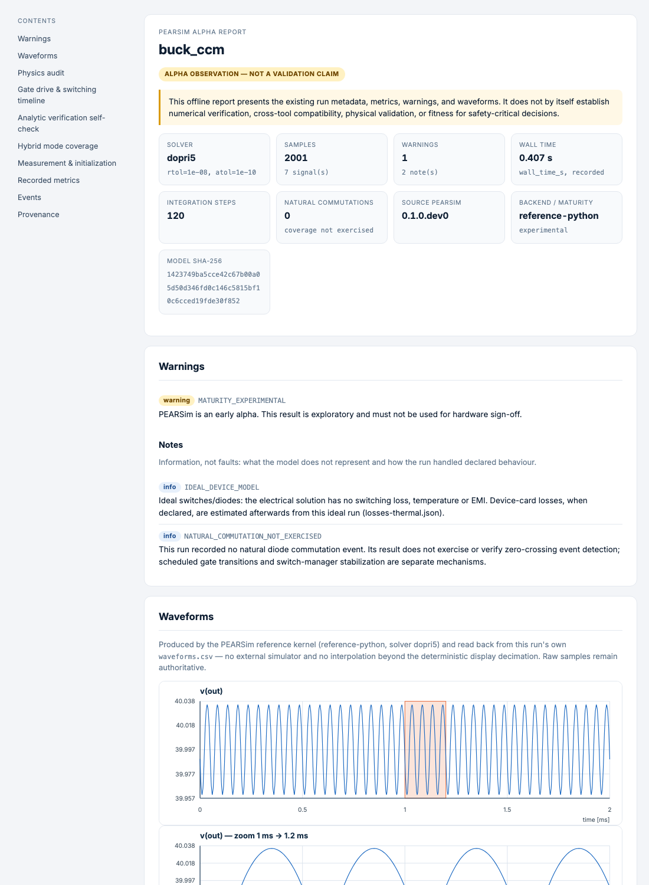

# PEARSim

A headless, deterministic power-electronics simulator you drive from a text file, a
command line or an AI agent. Models are YAML, runs are directories of hash-manifested
artifacts, and every number the tool prints can be traced back to the model, the request
and the solver settings that produced it. Published by
[PEAR Power](https://github.com/PEAR-power).

> [!WARNING]
> **Early alpha. Do not use for design sign-off, protection settings, safety analysis,
> or regulatory evidence.** The claim boundaries below are part of the product, not
> disclaimers to skim: where a capability is unproven this tool says so, refuses to
> guess, and records the refusal.

**Contents:** [Install](#install) · [Five minutes](#five-minutes) ·
[From an AI agent](#from-an-ai-agent-mcp) · [What it simulates](#what-it-simulates-today) ·
[How results are proven](#how-results-are-proven) ·
[What it does not do](#what-it-deliberately-does-not-do) ·
[Reproducibility](#reproducibility) · [Working with it](#working-with-it) ·
[Contributing](#contributing)

## Why PEARSim

1. **Evidence kept, not asserted.** Results are checked against closed forms written
   independently of the solver, against an open second engine (ngspice), and against
   per-run physics invariants such as the energy balance. The comparison records live in
   the repository and anyone can regenerate them.
2. **It refuses instead of guessing.** Unknown capabilities are treated as unsupported,
   invalid circuits fail with a named error instead of hidden regularization, and every
   result carries its warnings and a confidence level. A capability registry
   (`pear-sim capabilities`) states what is supported, experimental or unsupported.
3. **Built for agents as much as for people.** The same contract runs through the CLI, a
   typed Python API and an MCP server, so an AI agent can write, validate and simulate
   models and read back compact, auditable results.

## Install

> [!NOTE]
> The first release to PyPI is pending. Until it is out, install from a source checkout:
>
> ~~~console
> git clone https://github.com/PEAR-power/pear-sim && cd pear-sim
> uv sync --locked --extra dev        # or: pip install -e ".[mcp]"
> ~~~

Once released:

~~~console
pip install pear-sim                # the simulator: CLI and Python API
pip install "pear-sim[mcp]"         # plus the MCP server (pear-sim mcp)
uvx pear-sim-mcp                    # or run the MCP server without installing anything
~~~

Requires Python 3.11+ on Linux, macOS or Windows. Runtime dependencies are numpy, scipy,
PyYAML and jsonschema — no Docker, no browser, no proprietary simulator.

## Five minutes

~~~console
pear-sim lint examples/buck.yaml                      # validate model + topology
pear-sim explain examples/buck.yaml --json            # resolved values, assumptions, limits
pear-sim simulate examples/buck.yaml --out runs/buck  # portable run bundle
pear-sim report runs/buck --out reports/buck          # offline HTML, no network
~~~

(From a source checkout, prefix the commands with `uv run`.)

The report is a single offline HTML file: run metadata and hashes, every warning, the
waveforms (each fast-switching signal also drawn as an undecimated zoom, so PWM stays
visible), the physics audit, switching timeline, losses and junction temperatures when
device cards are declared, and provenance.

  

### From an AI agent (MCP)

PEARSim ships an [MCP](https://modelcontextprotocol.io) server, so Claude, Codex, Cursor
or any other MCP client can write, validate and simulate models for you:

~~~console
claude mcp add pear-sim -- uvx pear-sim-mcp                              # after the PyPI release
claude mcp add pear-sim -- uv run --project /path/to/pear-sim pear-sim mcp   # from a checkout
~~~

Run it from your own project directory: that is the directory the server may read models
from, and its runs go to `.pear-sim/` there. (Use `--project`, not `--directory`: the
latter would move the server into the PEARSim checkout.)

Then ask, for example, *"Design a 48 V to 12 V, 10 A synchronous buck at 200 kHz and
check the output ripple"*. The agent starts from a shipped example, validates the model,
simulates it and reports the numbers together with the tool's warnings — in our
[agent evaluation](evals/mcp/README.md) Claude Opus 5.5 passed 33 of 33 graded runs (11
engineering tasks × 3), with every quoted number checked against the simulator. Configuration
for other clients, the tool list and the safety rules (closed filesystem boundary, time
limits, compact results): [agent interface](docs/agent-interface.md).

A buck in full, so you can see the whole format at once:

~~~yaml
schema: pear-sim/v0.1
name: buck_ccm

parameters:
  vin: 100 V
  fsw: 20 kHz
  duty: 40 %
  load: 10 ohm

circuit:
  ground: gnd
  components:
    - {id: vin,  type: voltage_source, p: in,  n: gnd, value: "${vin}"}
    - {id: q1,   type: ideal_switch,   p: in,  n: sw,  control: pwm, initial: on}
    - {id: d1,   type: diode,          p: gnd, n: sw,  initial: off}
    - {id: l1,   type: inductor,       p: sw,  n: out, value: 1 mH,   initial_current: 4 A}
    - {id: c1,   type: capacitor,      p: out, n: gnd, value: 100 uF, initial_voltage: 40 V}
    - {id: load, type: resistor,       p: out, n: gnd, value: "${load}"}

controls:
  pwm: {type: pwm, frequency: "${fsw}", duty: "${duty}", phase: 0 s}

analysis:
  transient: {start: 0 s, stop: 2 ms, output_step: 1 us, solver: dopri5, rtol: 1.0e-8, atol: 1.0e-10}

outputs: [v(out), i(l1), i(q1), i(d1)]
~~~

Units are explicit and checked (`100 uF`, `20 kHz`, `40 %`). There is no expression
language: `${1/fsw}` is an error, not a feature — a value you cannot name is a value you
cannot audit. Full contract: [model format](docs/model-format.md).

---

## What it simulates today

**Kernel.** Event-driven piecewise-LTI state space (modified nodal analysis with a diode
active set). Switching instants are located, not stepped over: scheduled gate edges and
natural commutations both become exact events, and capacitor voltages and inductor
currents stay continuous across them.

| Area | What works | Example to start from |
|---|---|---|
| DC-DC | buck, boost, inverting buck-boost in CCM/BCM/DCM with natural diode turn-off | `examples/buck.yaml`, `boost.yaml`, `buck_dcm.yaml` |
| Isolated | DAB (phase shift), half-bridge LLC with resonant tank | `dab_phase_shift.yaml`, `llc_resonant.yaml` |
| Rectifiers | half-wave, 6-pulse on a transformer, 12-pulse Y-y-d with coupled winding groups, phase-controlled thyristor | `rectifier_12pulse_yyd.yaml`, `thyristor_phase_controlled.yaml` |
| Inverters | three-phase two-level (six-step, SPWM, SVPWM), floating neutral, weak grid, grid-following with PLL in the loop | `inverter_three_phase_spwm.yaml`, `grid_following_converter.yaml` |
| Multilevel | three-level NPC and five-level DNPC, three-phase, incl. DC-midpoint balance | `npc_three_phase.yaml`, `npc5_three_phase.yaml` |
| Machines | PMSM (sinusoidal back-EMF), salient-pole and synchronous reluctance machines, flux maps ψ(i_d, i_q), DC drive with H-bridge (machines are experimental) | `pmsm_inverter_drive.yaml`, `synrm_torque_test.yaml`, `dc_drive_hbridge.yaml` |
| Magnetics | mutual coupling, coupled winding groups (3×3 and larger), saturable inductor | `transformer_rl.yaml`, `rl_sat_inductor.yaml` |
| Devices | ideal or piecewise-linear switches and diodes (`on_resistance`, `forward_voltage`), MOSFET as switch + body diode | `sync_buck_mosfet.yaml` |
| Control | fixed PWM, complementary PWM with dead time, three-phase SPWM/SVPWM, level-shifted NPC modulation, sampled PI and dq current loops, a signal-block layer with a `pi` block | `synchronous_buck_complementary.yaml`, `buck_closed_loop_signals.yaml` |
| Losses & thermal | device cards (conduction LUT, switching energies), Foster networks, air and liquid cooling, efficiency map, rainflow counting | `buck_with_loss_cards.yaml`, `traction_inverter_liquid_cooled.yaml` |

**Analyses beyond a single transient:** periodic steady state by Newton shooting
(including inductor-star topologies), small-signal loop gain with phase/gain margins for
a *declared* compensator — with the ZOH and computation-delay term, because a continuous
Bode plot on a digitally controlled converter is optimistic by tens of degrees — modal
resonance audit, event-aligned Fourier/THD, bounded parameter and tolerance-corner
sweeps. Sweeps run their points in parallel (`--jobs`, default all cores but one); the
retained results do not depend on the job count.

**Reuse.** Declared subcircuits let you write a bridge once and instantiate it: the
twelve-pulse rectifier is one `three_phase_diode_bridge` definition used twice. Expansion
is deterministic and happens at load time, so hierarchy is presentation and never
physics — a flat and a hierarchical spelling of the same circuit produce the same physics
hash and bit-identical waveforms.

---

## How results are proven

This is the part the project exists for. Every claim above sits on one of three
independent classes of evidence, and the evidence is kept, not asserted:

1. **Closed forms.** Analytic RC/RL/RLC transients, conversion ratios, Foster impedance,
   R-L phase-controlled rectifier extinction angles, canonical periodic oracles for
   buck/boost/inverting buck-boost written independently of the solver (the oracle layer
   never imports the kernel).
2. **A second, open engine.** An ngspice differential adapter over the linear subset,
   with a relative budget and the resampling term declared explicitly. Anyone can rerun
   it: install ngspice and run `uv run pytest tests/test_ngspice_oracle.py`.
3. **Physics invariants.** Per-run energy balance, KCL/KVL structure, mode-coverage
   observations, and analytic self-checks on recognized topologies.

Comparison records live in [`validation/oracle-records/`](validation/oracle-records/):
each carries the deviation actually measured against the tolerance declared, and every
record must be regenerable by a test in this repository. Agreement between two simulators
is *verification* (the implementation solves the model it claims to), not *validation*
against hardware — no claim here rests on measurements. Where a capability has no
independent comparison at all, its capability entry says so.

Machine-readable status for every capability, including the unsupported ones:

~~~console
uv run pear-sim capabilities --json
uv run pear-sim capabilities --id analysis.steady_state.shooting
~~~

---

## What it deliberately does not do

Read this before trusting a number.

- **Piecewise-linear devices at best.** A switch or diode is ideal unless you give it
  `on_resistance` / `forward_voltage`; then conduction is `v = V_f + R_on·i` in the
  circuit equations. There is no reverse recovery, no switching transient, no
  temperature dependence and no EMI, and no parasitics unless you declare them as
  circuit elements (ESR and DCR are series resistors). Switching losses come *after*
  the run from declared cards, so that dissipation never feeds back into the solution —
  **the electrothermal loop is open by decision**, and the Jacobian says so on its face.
- **No part catalogue.** Every device card shipped in this repo is synthetic. A loss or
  temperature number is exactly as good as the card it came from, and the tool cannot
  tell you the card is fiction.
- **Not a general DAE solver.** Capacitor loops, general inductor cutsets and arbitrary
  floating-state topologies are refused with a named `TopologyError`, not silently
  regularized with hidden `gmin` or leakage. Narrow, documented zero-current and
  inductor-star paths are covered; anything else fails closed.
- **Bounded active set.** Diode active-set search is bounded (64 devices, a candidate
  budget); exhausting the budget is an error carrying the first cause, never a guess.
- **Margins attest a declared compensator** on an averaged model of one PWM leg in CCM,
  not a closed-loop proof: you state the compensator and the tool tells you what it
  implies. Closed-loop time-domain runs use the signal-block layer (including a `pi`
  block), which is a separate, simulated thing.
- **Modal and coverage reports are observations, not verdicts.** A run with zero natural
  commutations means that coverage was *not exercised* — never that the mechanism passed.
- Out of scope entirely: real-time/HIL, production code generation, FEM/PCB/field
  simulation, native model files of commercial simulators, bit-for-bit reproduction of another simulator.

Unknown capability is treated as unsupported. If you can get the tool to produce a
confident number outside these boundaries, that is a bug worth reporting.

---

## Reproducibility

`simulate` refuses to overwrite a non-empty directory and writes a portable bundle:
`run.json` (manifest, hashes, platform), `model.resolved.json`, `waveforms.csv`,
`events.jsonl`, `metrics.json`, `physics-audit.json`, `mode-coverage.json`,
`confidence-card.json`, `warnings.json`, `summary.json`, plus an `artifact-manifest.json`
with SHA-256 and byte count for every file. Topology- and analysis-specific artifacts
(`analytic-checks.json`, `gate-drive.json`, `resonance.json`, `losses-thermal.json`,
`harmonics.json`, `modulation-cycles.jsonl`, …) appear when the model calls for them.

### Lean runs (`--lean`)

A parameter search runs the same circuit hundreds of times and reads three numbers back;
it does not read the energy balance of run 417. `simulate --lean` is that run: it skips
the per-component power quadrature and the dense state-extrema search outside the
reported last-half window, which is most of the cost of a run.

It is a reduction of *claims*, not of accuracy. Everything a lean run still reports —
waveforms, `metrics.json`, `mode-coverage.json`, the published `state_extrema` — comes
out of the identical code path and is **bit-for-bit identical** to the full run's; the
integration itself is untouched, so the step sequence and the trajectory match exactly.
What is dropped is dropped whole, never approximated: `physics-audit.json` carries
`status: not_computed`, and per-interval extrema outside the reported window are `null`
with `state_extrema_method: not_computed_in_lean_evidence_mode`.

A lean bundle says so in four places — the console, `warnings.json`
(`EVIDENCE_MODE_LEAN`, severity `warning`), `summary.json` and `run.json`
(`evidence_mode`) — and `evidence_mode` is written in both modes, so a full bundle
states its scope rather than implying it by silence. Screen with `--lean`, then re-run
the finalists without it: that is the run you show.

Four hashes bind a result: source, resolved physics model, request and run. Two spellings
of the same circuit share a physics hash; a changed tolerance changes the request hash.
This is what makes "did anything actually change between these two revisions?" a
mechanical question — see `pear-sim compare`.

Metrics are continuous-time quadratures over topology segments; anything computed on the
requested grid is named `sample_*` so the two are never confused. Adaptive solvers take
different internal steps across platforms and versions, so comparisons belong on an
explicit output grid with declared tolerances, never on byte equality.

Exit codes: `0` all applicable blocking checks passed · `1` evidence retained with a
blocking `fail` / `not_comparable` / `not_run` · `2` invalid request, input, topology or
destination.

---

## The design-loop layer (in progress)

Beyond running one model, the project is growing the pieces needed to *choose* a design
rather than only check one. These are early and marked experimental:

- **[Design specification](docs/design-spec.md)** — requirements as a typed object that
  separates hard constraints from soft ones and asks a question instead of inventing a
  default.
- **[Topology library](docs/topology-library.md)** — one YAML file per topology:
  prerequisites, the switching cycle as data, and a mandatory list of known limitations
  (an empty list is a claim, so the format refuses it).
- **Gradient engine** — sensitivities of steady-state metrics to design parameters
  (duty, dead time, L, C, load, phase shift) computed on the exact period map, with
  saltation for natural commutation. It gives direction; the oracle remains the only
  thing that issues a pass.

Direction and open items: [component roadmap](docs/component-roadmap.md) and the issue
tracker.

---

## Working with it

`pear-sim --help` is the command reference. Beyond the four commands above:
`catalog`, `capabilities`, `spec`, `render`, `evaluate`, `analyze`, `compare`, `sweep`,
`verify`, `review`, `topology`, `doctor`, `mcp`.

Three surfaces, one contract: the CLI, a typed Python API (`pear_sim.api`,
[docs](docs/api.md)) and the MCP server ([agent interface](docs/agent-interface.md)) — the
same scenario through any of them produces a bit-identical `run_sha256`.

`pear-sim doctor` reports versions, package integrity, available oracle backends and a
float-determinism probe — run it first when results differ between two machines.

Reviewing work: `review prepare` builds a hash-bound packet of what was simulated,
`annotate` appends hash-chained comments, `check` verifies integrity and decision
binding. It is an auditable transport format — **not** a signature authority and not
organizational authorization; reviewer identity is not authenticated.

Development: `uv run pytest` (about 1,200 tests) and `uv run ruff check .` must be green
per commit. Contributor rules: [CONTRIBUTING.md](CONTRIBUTING.md) and
[AGENTS.md](AGENTS.md); architecture in [docs/architecture.md](docs/architecture.md).

CI runs Linux (Python 3.11 and 3.13), Windows and macOS.

---

## Implementation notes

The kernel is event-driven and piecewise linear: between two switching events the circuit
is a linear time-invariant system assembled by modified nodal analysis, and the events —
scheduled gate edges and natural diode commutations — are located as exact instants, not
stepped over. That keeps capacitor voltages and inductor currents continuous, makes runs
deterministic, and lets steady state, small-signal averaging and sensitivities work on the
same exact period map. Details and the reasons behind the main choices:
[architecture](docs/architecture.md) and the [ADRs](docs/adr/). A compiled core is planned
as an optional backend behind the same model format, CLI and MCP contract.

## Contributing

Contributions are welcome — please read [CONTRIBUTING.md](CONTRIBUTING.md) first. In short:
every change rests on public mathematics, standards, openly licensed sources or your own
work; no proprietary or decompiled code, copied component libraries or demo models, or
model files from commercial tools; every bugfix starts with a failing test; and a new
capability is registered with honest claim boundaries.

Unless you explicitly state otherwise, any contribution intentionally submitted for
inclusion in this project is licensed under the Apache License 2.0, without any additional
terms or conditions.

The product name is **PEARSim**; the distribution and the executable are `pear-sim`, the
import package is `pear_sim` — see [ADR 0003](docs/adr/0003-pear-sim-naming.md).

## License

Copyright 2026 PEAR Power and the PEARSim contributors.

Licensed under the [Apache License, Version 2.0](LICENSE). The license does not grant
permission to use the PEAR Power or PEARSim names or logos except as required to describe
the origin of the software. Third-party datasets, examples and optional backends keep their
own notices.
